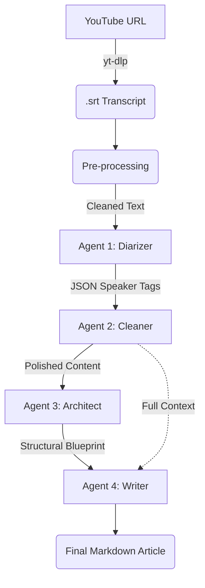

# 🎥 YouTube TechTalk-to-Article

Transform YouTube technical presentations into premium, structured Markdown articles using Google's Gemini models. This tool uses a multi-agent pipeline to ensure technical accuracy, speaker attribution, and professional narrative flow.

## 🏗️ Architecture



## 🛠️ Prerequisites

- **Node.js** (v18+)
- **[yt-dlp](https://github.com/yt-dlp/yt-dlp/wiki/Installation)** (Available in PATH)
- **[FFmpeg](https://ffmpeg.org/download.html)** (Required for subtitle conversion)
- **Google Gemini API Key** ([Get one here](https://aistudio.google.com/))

## 🚀 Quick Start

1. **Clone & Install:**

   ```bash
   git clone https://github.com/idshdx/Youtube2Article.git
   cd Youtube2Article
   npm install
   ```

2. **Configure:**

   Create a `.env` file:

   ```env
   GEMINI_API_KEY=your_api_key_here
   ```

3. **Run:**

   ```bash
   npm start <YouTube URL> [output_name]
   ```

### Example

```bash
npm start https://youtu.be/j3AUC0x_ju8 intro-mixnets

```

## 📦 Pipeline Output

The process generates resources in the `/dist` folder:

- **`*_cleaned.txt`**: The polished, diarized transcript.
- **`*.md`**: The final high-quality technical article.

## 🧠 How it Works

1. **Extraction:** Uses `yt-dlp` to fetch the auto-generated English transcript as an `.srt` file.
2. **Pre-processing:** Cleans the raw SRT formatting and shapes the text for the pipeline.
3. **Diarization:** The **Diarizer Agent** identifies speaker changes and labels segments (Host, Speaker, Audience).
4. **Refinement:** The **Cleaner Agent** receives the JSON response, removes verbal fillers, and performs rolling deduplication of auto-caption errors.
5. **Architecting:** The **Architect Agent** analyzes the polished text to create a structural "Blueprint" with section titles and detailed summaries.
6. **Synthesis:** The **Writer Agent** uses the Architect's blueprint alongside the full Cleaner output to synthesize a cohesive, authoritative technical article.

---
*Next: Video frame change recognition and OCR patterns for automatic graphic asset embedding.*
