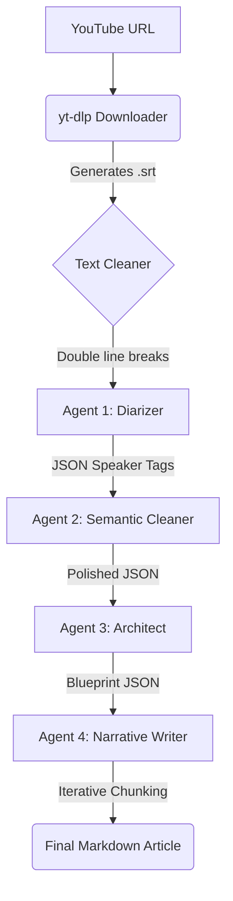

# YouTube TechTalk-to-Article

This application converts YouTube technical presentations into high-quality, unified Markdown articles using Google's Gemini models.

## Architecture



## Prerequisites

1. **Node.js** installed on your machine.
2. **`yt-dlp`** installed and available in your system's PATH. ([Installation guide](https://github.com/yt-dlp/yt-dlp/wiki/Installation))
3. **`ffmpeg`** installed and available in your system's PATH (required for subtitle conversion to SRT). ([Installation guide](https://ffmpeg.org/download.html))
4. **Google Gemini API Key**: Get one from [Google AI Studio](https://aistudio.google.com/).

## Setup

1. Clone or navigate to this repository.
2. Install dependencies:

   ```bash
   npm install
   ```

3. Create a `.env` file in the root directory and add your API key:

   ```env
   GEMINI_API_KEY=your_actual_api_key_here
   ```

## Usage

Run the tool with a YouTube URL as an argument, and an optional second argument for the output filename:

```bash
npm start <YouTube URL> [optional_output_name]
```

### Example

Here is a full example of converting a technical presentation on Mixnets:

```bash
npm start https://youtu.be/j3AUC0x_ju8 intro-mixnets-katzenpost
```

#### Original Video

[](https://youtu.be/j3AUC0x_ju8)

#### Output Files

The pipeline creates the following resources in your `/dist` output folder:

- **Cleaned Transcript:** `dist/intro-mixnets-katzenpost_cleaned.txt`
- **Final Article Output:** [`dist/intro-mixnets-katzenpost.md`](dist/intro-mixnets-katzenpost.md)

### How it Works

1. Uses `yt-dlp` to download the auto-generated English transcript as an `.srt` file.
2. Cleans text and shapes it for the Diarizer.
3. The Cleaner agent receives the json labeled response from the Diarizer agent.
4. The Architect Agent takes the Cleaner output and makes structural "Blueprint" with titles and detailed summary of the points for each section.
5. The Writer Agent uses the structural blueprint from the Architect together with the whole content from the Cleaner to create an article.
6. Outputs the cohesively synthesized content to `/dist` in Markdown.


### Next 
Video frame change recognition and OCR patterns in order to recreate and embed the graphic assets in the markdown files.
